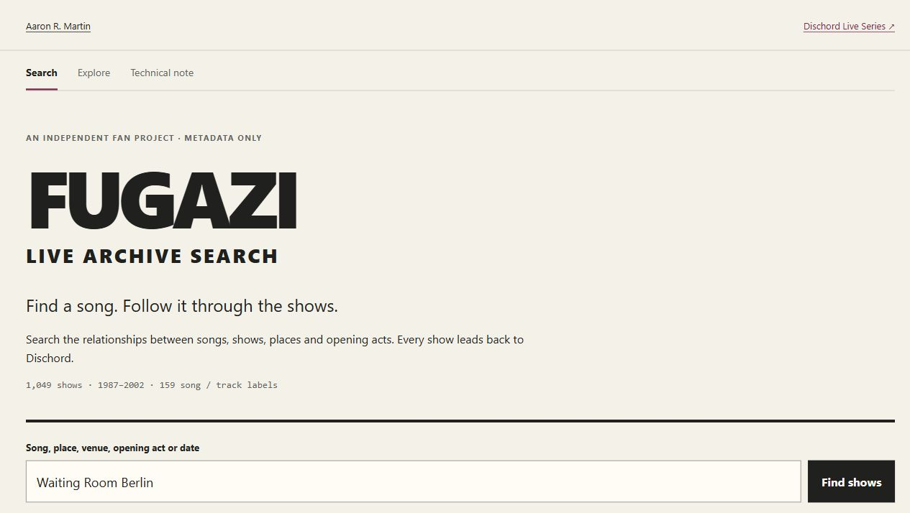
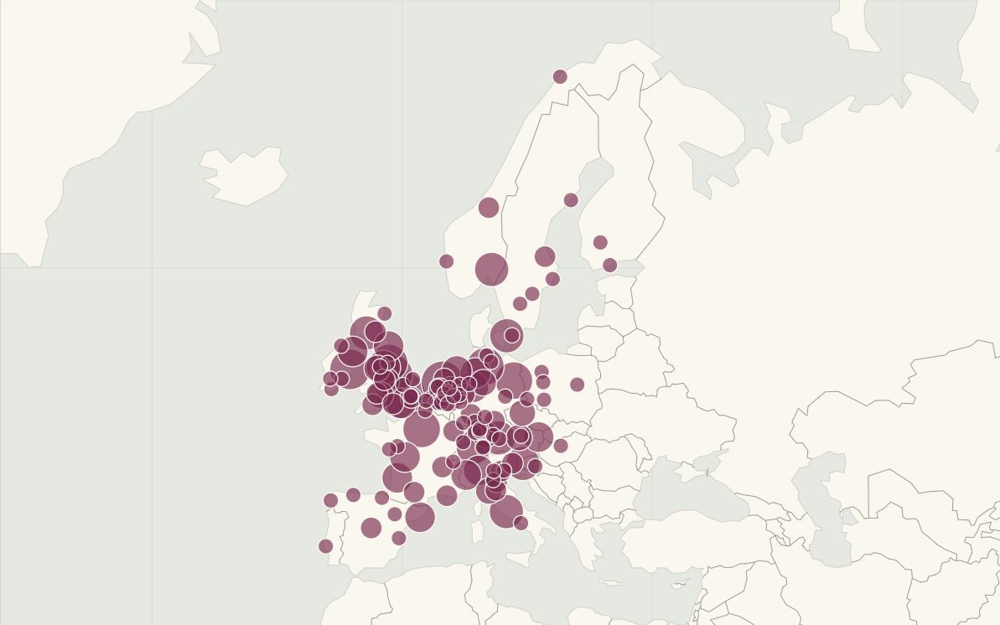
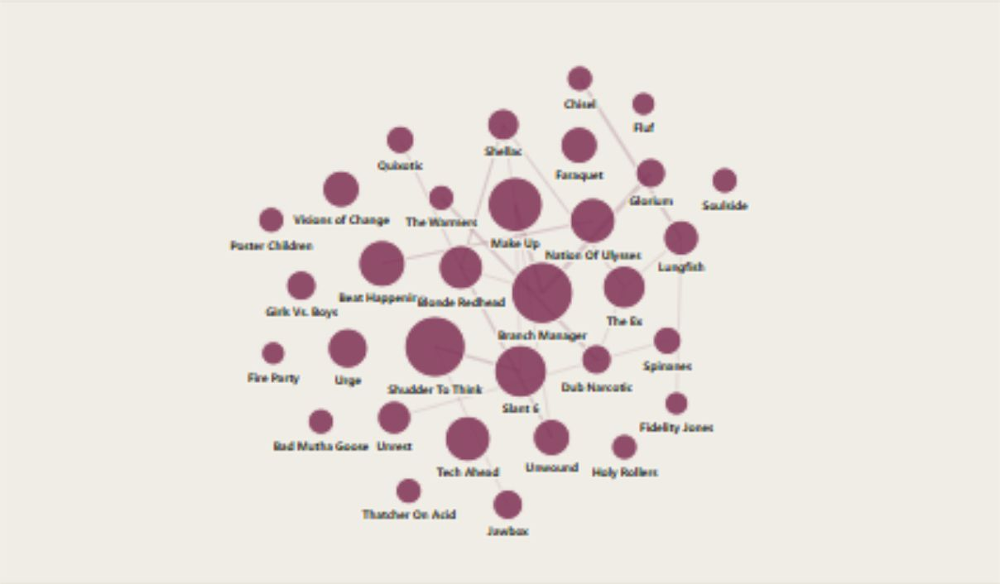

# Fugazi Live Series: search and explore

[Search](https://aaron-martin-phd.dev/fugazi/) · [Explore](https://aaron-martin-phd.dev/fugazi/explore.html) · [Technical note](https://aaron-martin-phd.dev/fugazi/technical.html)



Fugazi is my favorite band. Ian MacKaye is a legend. This is a knowledge graph and static search app for finding which songs were listed in which sets, and following each show back to Dischord.

Go and visit [Dischord Records](https://dischord.com/) and find some good music.

## Archive metadata and provenance

Collects metadata from the public [Fugazi Live Series archive](https://dischord.com/fugazi_live_series) and converts it into a simple graph JSON file. The crawler requests HTML pages only. It does not request audio, samples, images, or purchase/download endpoints.

The collected fields prioritize the show ID, date, venue, city, subdivision, country, opening acts, ordered setlist, and source page URLs. Missing fields are left empty; the archive is mapped as published rather than filled from outside sources.

## Current features

The public site is live on the owner's Quarto / GitHub Pages website. Python builds the graph; plain JavaScript searches and summarizes it in the visitor's browser. There is no production database, backend, LLM, embedding model or inference service.

| View | What it does |
| --- | --- |
| Search | Match songs, shows, places, venues and opening acts; intersect multiple selections; filter by year/country; inspect ordered setlists and follow original Dischord links. Each show now has a shareable URL and a visible Setlist control. |
| Explore | Top 20 release-matched songs by distinct shows; city map with region views; opening-act network with weighted shared-bill connections. Shared year/country filters apply to all three; a separate Song region control compares regional top-20 rankings. |
| Technical note | Collection, provenance, graph schema, exact search behavior, metric definitions, validation and the browser implementation. |

The current graph has **3,529 nodes and 31,260 edges**, covering **1,049 shows from 1987–2002**, **159 song/track labels**, and **24,562 listed track occurrences**. There are 97 shows without listed setlists and 69 labels requiring review; missing data remains unknown. The map covers 1,025 shows across 400 matched city records; 24 shows / 19 unresolved locations remain unplotted.

<table><tr><td></td><td></td></tr><tr><td>Derived city coordinates; modern borders only in regional maps.</td><td>Node area = appearances with Fugazi; links = shared bills.</td></tr></table>

Search reads the full graph; the opener visualization is a derived slice, not a drawing of the entire database. Text matching is deterministic, with exact entity names, explicit selections and substring fallback—not semantic similarity. Selecting five songs returns the shows linked to all five. Exclusions, free-form instructions and track-order queries are not implemented.

Read [why I built this](https://aaron-martin-phd.dev/homelab/#fugazi-live-series) for the personal story. This is an independent fan project, unaffiliated with Fugazi or Dischord Records. Recordings and purchases stay with Dischord.

## Setup

```powershell
uv sync
```

## Collect show metadata

```powershell
uv run python scrape_fugazi.py
```

The default output is `data/fugazi_shows.json`. HTML responses are cached in `.cache/dischord` so interrupted or repeated runs can reuse pages. The crawler reads `robots.txt` before making archive requests and uses a one-second delay before each uncached page request.

Options:

```powershell
uv run python scrape_fugazi.py --output data/fugazi_shows.json --cache-dir .cache/dischord --delay 1.0
```

## Build graph data

```powershell
uv run python build_graph.py
```

The default output is `data/fugazi_graph.json` (schema version 2), with `nodes`, `edges`, and an album palette. Each show links to separate country, state/subdivision, city, and venue nodes. Locations have deterministic UUID-based IDs scoped by their parent locations. Missing levels remain missing; historical country labels stay as published.

Songs use explicit IDs and canonical display titles from the tracked `catalog.json`. Editing a song's title while keeping its ID preserves identity. Case, Unicode composition, and whitespace normalize automatically; punctuation is preserved unless an explicit alias says otherwise. Venue display names normalize whitespace and case variants within the same location. Substantive spelling changes and cross-city venue aliases require review, rather than fuzzy matching. Original location text stays on show nodes; every performance edge retains its original title and position.

Album grouping follows the first official release, with **13 Songs** combining the first two EPs by project preference. Its color is dark pink/purple (`#8B2F60`). Other colors are editable cover-inspired drafts. Verified release matches have album IDs and colors; unverified tracks use neutral gray. Live instrumental variants and generic labels such as Intro remain separate and need review rather than automatically inheriting an album. The catalog stores official Fugazi Bandcamp source URLs for release matches; this is derived enrichment separate from the untouched archive records.

Schema 2 replaces the original slug IDs and combined place nodes. Regenerate downstream exports; old graph IDs are not compatible. Location aliases can be configured in `catalog.json`: each key is a JSON array of parent IDs (or `missing:<type>` markers) followed by the normalized raw name, and its value is the canonical name. Canonical location renames change derived IDs, so add aliases and rebuild dependent exports together. Song IDs are stored and must not be regenerated when changing display labels.

## Neo4j Desktop import

Run `uv run python export_neo4j.py` after building the graph. It writes `data/neo4j/fugazi_nodes.csv`, `fugazi_edges.csv`, `import.cypher`, and a count manifest. This targets Neo4j 5.26+ (including the project's Desktop 2026.10 instance) and uses built-in `LOAD CSV`, without APOC.

In Desktop, open the local instance's import folder and copy the two CSV files there. In Query, connect to the intended database and run each numbered block from `data/neo4j/import.cypher` separately, in order. Verify the returned counts against the manifest. The original JSON files remain the source dataset; this export also turns the album catalog into Album nodes with FIRST_RELEASED_ON relationships. Existing demo nodes are separate from the imported FugaziEntity nodes.

The importer preserves IDs, uses MERGE for repeatable imports, and preserves position/original title on PERFORMED relationships. Nested JSON/list fields are preserved as text properties ending in `_json`. Dates remain ISO strings. Reimport updates/adds records but does not delete records removed from later exports. CSV files must be in the instance import directory; selecting them in the visual Import tool is a different workflow.

## Regression tests and normalization review

```powershell
uv run python -m unittest -v
uv run python audit_graph.py
```

The audit checks unique IDs, valid edge endpoints, preservation of all performances, and deterministic output independent of show order. It writes `data/normalization_review.json` with unmatched track labels and standardized location variants. The tests use synthetic shows and HTML and require no crawl or local dataset.

Before visualization, review uncertain track identities, assign their release groups where supported, and confirm the cover palette. Unknown does not mean unreleased; covers, unreleased songs, and spoken/interlude labels need explicit classification. A viewer should show album labels alongside color so meaning does not depend on color alone.

## Static search app

The current dataset covers **1,049 shows, 1987–2002**, with **159 song/track labels** and 24,562 listed track occurrences. Labels include intros, interludes and variants; 69 require identity review. There are 97 shows without listed setlists. Missing data stays unknown.

The app in `web/` uses plain HTML, CSS and JavaScript modules. There is no production database, backend, LLM or query service. Text queries match graph entities and their recorded show relationships. Select multiple entities to intersect their connected shows; co-occurrence counts each show once. Show cards and details link directly to Dischord.

The [Explore view](https://aaron-martin-phd.dev/fugazi/explore.html) adds a top-20 song chart, a city map, and a network of opening acts sharing Fugazi bills. Year and country filters apply to all three. Songs are ranked by distinct shows and restricted to release-matched catalog entries; unresolved labels are excluded from this ranking. Opener node area represents appearances with Fugazi, while edges count shared bills between opener pairs. Network position has no analytical meaning. The top-20 chart also has a separate geographic-region filter, using archive country labels rather than map coordinates. Each selection links to source shows, preserving the region in Search.

The map uses a separate GeoNames coordinate layer and Natural Earth land geometry, with 400 matched city records covering 1,025 shows. Nineteen unresolved locations (24 shows) are listed rather than guessed. See [map sources and matching rules](web/GEOGRAPHY.md). Run `uv run python build_map.py --download` to refresh the local source snapshots, or omit `--download` to reuse cached geography. No map services are called at runtime.

Run `node --test web/graph.test.mjs web/metrics.test.mjs web/map-projection.test.mjs web/regions.test.mjs` after exporting to verify both search and Explore metrics against the original source records.

```powershell
uv run python export_web.py
Copy-Item data/web/data.json,data/web/manifest.json web/
python -m http.server 8766 --directory web
```

Open `http://localhost:8766/`. Run `node --test web/graph.test.mjs` after exporting to compare search results and setlists against source records. See [validation findings](VALIDATION.md) for the cached audit and the successful random sample of 20 Dischord pages.

### Downloadable graph schema (version 2)

`data.json` contains `schema_version`, `albums`, `nodes` and `edges`. The web export preserves the full graph while removing formatting whitespace. `manifest.json` records counts, date coverage, byte size, SHA-256 and provenance.

| Object | Fields and meaning |
| --- | --- |
| Node | `id`, `type`, `name`; types: `show`, `song`, `country`, `state`, `city`, `venue`, `band` (listed opening act) |
| Show | `show_id`, ISO `date`, `source_url`, `location_as_listed`, and nullable `country_id`, `state_id`, `city_id`, `venue_id` |
| Song / track | `album_id` (nullable), `color`, `review_status`, `titles_as_listed` |
| Location | `parent_id` (nullable), `names_as_listed` |
| Album | `id`, `name`, `color`, release source URL and curation status |
| Edge | `source` and `target` node IDs, `relation`; directed relationships: show `performed` song, show `opened_by` band, show `played_at` venue, show `happened_in` location, location `part_of` parent |
| Performance edge | Also has source `position` and `title_as_listed`; repeated rows and nonsequential numbers are preserved |

The graph is a multigraph: never deduplicate performance edges by endpoints. Source row order is recoverable by track position in the current dataset, whose only tied positions have identical labels. Song presence and co-occurrence should count distinct shows; track-occurrence totals describe listed rows, not verified distinct performances. Album enrichment comes from the separate curated catalog, not from Dischord show metadata.
